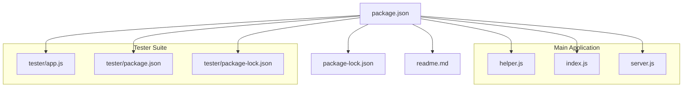
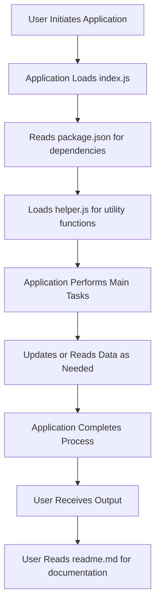

---
title: DataPi Test Data Management System
navOrder: 1
---

# DataPi Test Data Management System

## Overview

**What It Does**  
DataPi is a service-oriented framework designed to streamline the management of test data for automated testing environments. It provides an HTTP API that supplies synthetic and real data, enabling automation engineers to decouple data generation from test code. This separation enhances maintainability, reduces redundancy, and standardizes test data handling across projects.

**Key Features**  
- Exposes RESTful endpoints for generating random data, UUIDs, and database-derived data.  
- Supports dynamic data generation with configurable parameters.  
- Simple, lightweight server built with Fastify.  
- Easy to integrate with various testing tools and programming languages.  
- Extensible to include custom data sources or complex data generation logic.

**Project Status / Roadmap**  
The project appears to be in a stable, functional state, with core data provisioning features implemented. Future enhancements may include comprehensive testing, advanced data source integrations, and security features.

---

## Getting Started

### Requirements & Dependencies

- **Node.js** (version >= 8.0.0 recommended)  
- **NPM** (comes with Node.js)  
- **Dependencies:**  
  - `fastify` (v3.14.2)  
  - `mysql` (for database data retrieval)  
  - Additional dependencies for internal modules as listed in `package-lock.json`

### Installation

1. Clone the repository:

```bash
git clone https://github.com/automationpi/datapi.git
```

2. Navigate into the project directory:

```bash
cd datapi
```

3. Install dependencies:

```bash
npm install
```

### Running the Service

Start the DataPi server with:

```bash
node index.js
```

This will launch the service on **localhost:3000**. You can verify it's running by navigating to:

```
http://localhost:3000/
```

which should return:

```json
{"hello":"world"}
```

---

## Usage

### Basic Endpoints

- **GET /**  
  Returns a simple greeting message to confirm server availability.

- **GET /random**  
  Generates a random integer. Optional query parameter `length` specifies the maximum number (defaults to 1000).

```bash
curl "http://localhost:3000/random?length=5000"
```

- **GET /uuid**  
  Generates a UUID with optional `length` parameter (number of bytes, default 16).

```bash
curl "http://localhost:3000/uuid?length=32"
```

- **GET /getfromdb**  
  Retrieves data from a specified MySQL database. Requires proper database configuration, which is currently hardcoded in code (see configuration notes below).

```bash
curl "http://localhost:3000/getfromdb"
```

### Example: Generating a Random Email

```javascript
const datapi = require('datapi');

async function generateEmail() {
  const response = await datapi.dataHandler.inject({
    method: 'GET',
    url: '/email'
  });
  console.log(response.body);
}

generateEmail();
```

### Example: Generating a User Full Name

```javascript
const datapi = require('datapi');

async function generateUserName() {
  const response = await datapi.dataHandler.inject({
    method: 'GET',
    url: '/user'
  });
  console.log(response.body);
}

generateUserName();
```

---

## Architecture

### High-Level Overview

DataPi is a lightweight HTTP server built with **Fastify**, exposing endpoints for data generation. It leverages internal helper modules for data logic and supports external integrations like MySQL for dynamic data retrieval. The architecture emphasizes simplicity, extensibility, and ease of use.

### Core Concepts

- **HTTP API Endpoints**: for data requests
- **Helper Module**: contains predefined data arrays and utility functions for randomization
- **Main Server**: handles routing, data generation, and response delivery
- **Database Integration**: optional, for fetching real data

### Design Decisions

- Use of Fastify for high performance and minimal footprint  
- Data sources are modular and easily extendable  
- Configuration is currently hardcoded but can be externalized for flexibility

---

## API Reference

### Public Classes / Modules

- **`index.js`**: Main server entry point, initializes Fastify server, defines routes  
- **`helper.js`**: Provides static data arrays and utility functions for generating random names, domains, etc.

### CLI Commands

- To start the server:

```bash
node index.js
```

- To run tests or extend functionality, developers can create custom scripts as needed.

### Configuration Schema

- Currently, database connection details are hardcoded within route handlers.
- For production, externalize database configs via environment variables or config files.

---

## Troubleshooting & FAQ

### Common Errors

- **Server not starting:** Ensure Node.js v8+ is installed and dependencies are installed (`npm install`). Check for port conflicts on 3000.
- **Database connection errors:** Verify MySQL server details and permissions.

### Known Issues

- Hardcoded database credentials; recommend external configuration for production.
- No authentication or security measures implemented.

### Support Resources

- GitHub Issues: [https://github.com/automationpi/datapi/issues](https://github.com/automationpi/datapi/issues)  
- Repository: [https://github.com/automationpi/datapi](https://github.com/automationpi/datapi)

---

## Security

### Security Model

The current implementation does not include authentication, authorization, or encryption. It is intended for internal or controlled environments.

### Reporting Vulnerabilities

Please report vulnerabilities via GitHub Security Advisories or contact the maintainers directly.

---

## Contributing

### Code of Conduct

Contributions should adhere to community standards and be respectful.

### How to Contribute

Fork the repository, create feature branches, and submit pull requests. Ensure code follows style guidelines.

### Development Setup

- Install dependencies: `npm install`  
- Run the server: `node index.js`  
- Extend functionality by adding new routes or helper functions

### Style Guide & PR Checklist

Follow existing code style, comment complex logic, and include tests where applicable.

---

## License

This project is licensed under the ISC License. See `LICENSE` file for details.

---

## Acknowledgements & Community

- Maintained by Naveen Alok  
- Community discussions via GitHub Issues  
- Contributions welcome

---

*This documentation is generated to assist developers in understanding, deploying, and extending the DataPi Test Data Management System.*

## Architecture Diagrams


### Architecture Diagram 1




### Architecture Diagram 2



